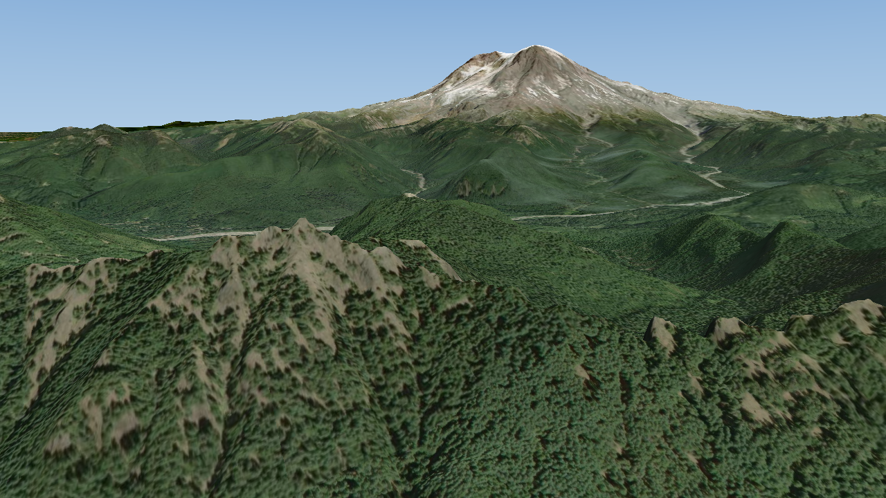
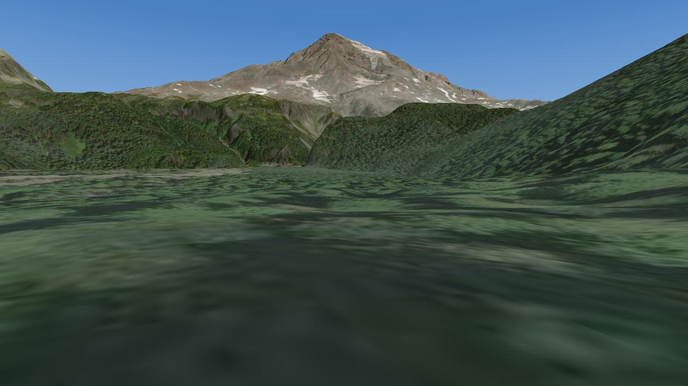
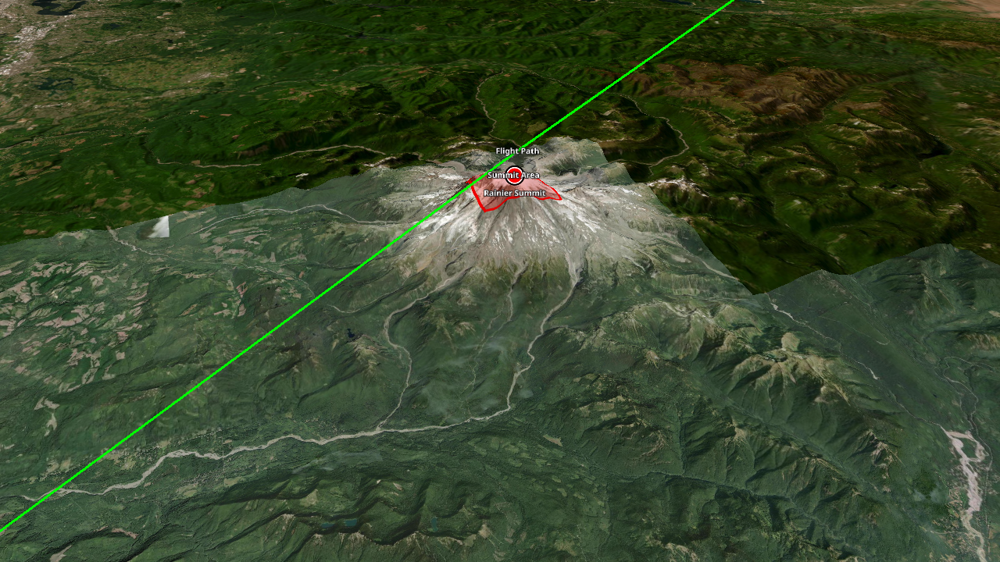
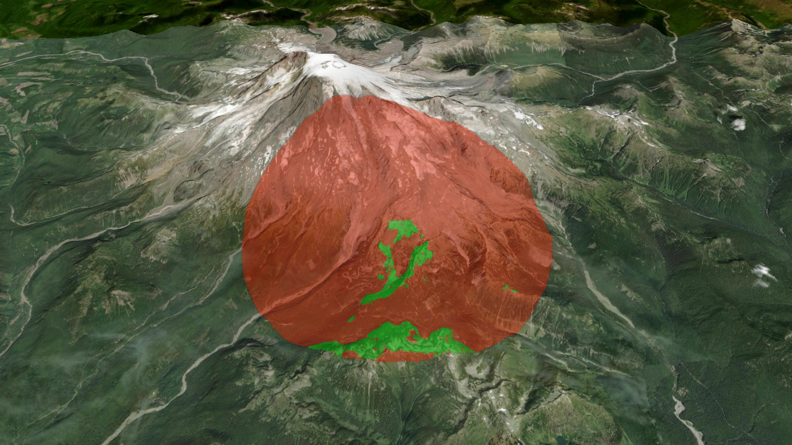
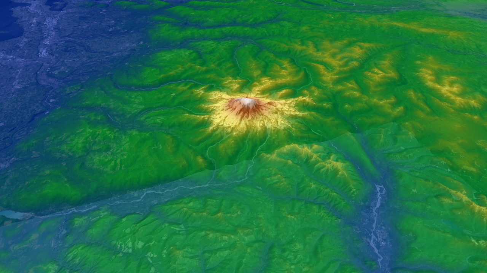
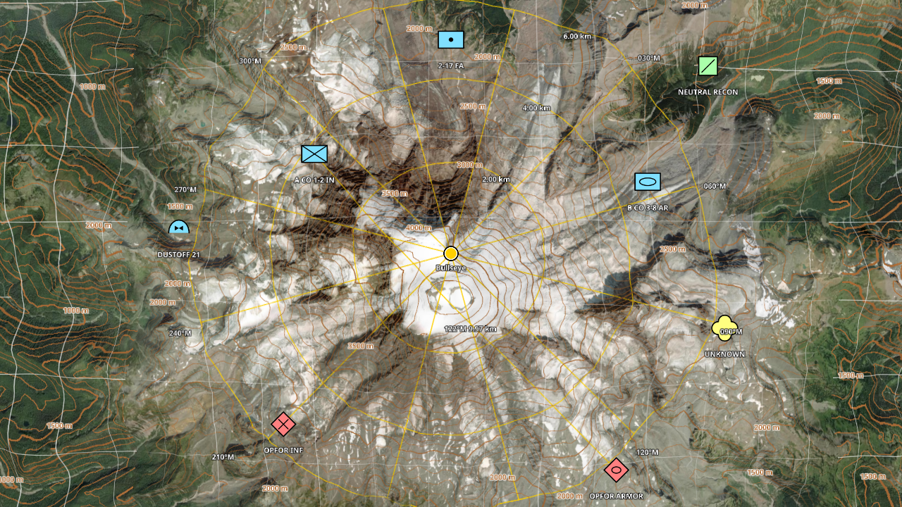
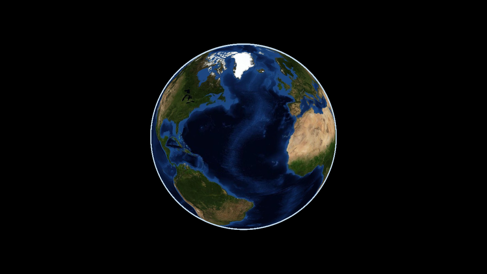

# OTKGlobeEngine

A lightweight, cross-platform C++ map engine modeled on the TAK map engine: a WGS84 globe draped with 2D imagery, 3D terrain, vector features, labels, 3D models and 3D Tiles.

Targets Windows, macOS, Linux (including the Raspberry Pi 4 and 5), Android, iOS and iPadOS from one codebase. Rendering goes through sokol_gfx (Direct3D 11, Metal, OpenGL 4.1, OpenGL ES 3) with shaders written once. CI builds all five targets on every push.

Website and downloads: https://grangedevgroup-code.github.io/OTKGlobeEngine/

[docs/EMBEDDING.md](docs/EMBEDDING.md) covers using the engine from Android, iOS, macOS, Windows, C# and Qt. [docs/FORMATS.md](docs/FORMATS.md) is the data import/export compatibility matrix, and [docs/OFFLINE.md](docs/OFFLINE.md) covers caching and airgapped networks. [docs/PHOTOREALISM.md](docs/PHOTOREALISM.md) covers photogrammetry and photorealistic 3D Tiles, [docs/XR.md](docs/XR.md) VR, AR and stereo, and [docs/MILITARY.md](docs/MILITARY.md) the military feature set.

| Globe | Terrain | First person |
| --- | --- | --- |
|  |  |  |
| **Vector tiles** | **3D Tiles** | **Features and labels** |
|  |  |  |
| **MGRS grid** | **Viewshed** | **Elevation heat map** |
|  |  |  |
| **2525 units, contours, bullseye, R&B** | **Terrain slope** | **Airgapped, empty cache** |
|  |  |  |

## Kernel and engine

The project builds two libraries, matching the split between the TAK kernel and the TAK map engine:

- **Kernel** (`otk_kernel`): GPU-free geospatial and data services that servers, tools and headless hosts can use without a display. Format detection, import and export (KML/KMZ, GeoJSON, GPX, Shapefile, CoT, CSV, WKT, GML, TAK data packages, ATAK iconsets, KLV); import planning (`planImport` decides how any file or folder should be loaded); feature queries by region, radius, CoT type, name, attributes and time (`FeatureQuery`); elevation queries, line of sight and profiles from any elevation source (`ElevationService`); MGRS, UTM, UPS, GARS and coordinate parsing; Vincenty geodesics and range-and-bearing shapes; WMM magnetic model; EGM96 geoid; sun and moon; MIL-STD-2525 symbol images; tile cache, offline mode and network access; tile archives (MBTiles, PMTiles, GeoPackage, osmdroid/RMaps/OsmAnd); OBJ and COLLADA to glTF conversion.
- **Engine** (`otkglobeengine`): the renderer on top of the kernel: globe, imagery, terrain, features, labels, models, 3D Tiles, point clouds, grids, input, plus `Engine::open` to load anything `planImport` understands and zoom-to-content helpers.

`-DOTK_ENGINE=OFF` builds only the kernel and its tests, with no graphics dependencies (Linux needs only libcurl).

## Features

**Globe and camera**
- TAK-style scene model: focus point, ground resolution, azimuth, tilt up to 84 degrees, terrain collision
- 2D/3D toggle, first-person mode (walk and look at eye height), animated fly-to
- Atmosphere and sky from ground level to space

**Imagery**
- Online XYZ, TMS, quadkey, WMS 1.1.1/1.3.0 (EPSG:3857 and 4326), WMTS templates, MOBAC XML (including multi-layer and WMS sources); Cesium, MapLibre and Leaflet URL placeholders (`{reverseY}`, `{westDegrees}`, `{bbox-epsg-3857}`, `{quadkey}`, `{r}` and more); custom request headers for keys and referers
- Offline MBTiles, PMTiles v3, GeoPackage tiles (any tile matrix), osmdroid, RMaps/BigPlanet and OsmAnd SQLite, and GeoTIFF/NITF/MrSID/JPEG2000/GeoPDF/CADRG via the optional GDAL module
- SQLite tile cache with offline mode and fallback, region download
- Mapbox Vector Tiles (TileJSON or MBTiles) rendered on the GPU with place, peak and water labels
- `file://` URL templates for offline `{z}/{x}/{y}` tile folders
- Layer stacking with opacity, KML/KMZ ground overlays, arbitrary image overlays

**Terrain**
- WGS84 quadtree, 33x33 post meshes with skirts, screen-space-error LOD, slope shading ("enhanced depth perception"), exaggeration, x-ray transparency
- Terrarium elevation tiles; Cesium terrain from `layer.json`, `{z}/{x}/{y}` templates or Cesium ion (quantized-mesh-1.0 and heightmap-1.0, tile availability, token refresh); DTED 0-3 and SRTM HGT folders, GDAL DEMs, EGM96 geoid (heights are HAE)
- Line of sight, viewshed, elevation profile, elevation heat map

**Vectors, labels and models**
- Built-in world labels, styled like a satellite map with labels: country, state and province, and county lines, and the names of countries, states, provinces, counties, cities, towns and villages worldwide, placed by importance with decluttering. The same switch adds roads in satellite-map style (gold motorways and trunk roads, gray arterials and streets, dashed tunnels and paths), interstate, US, state and route shields, street names along the roads ("22nd Ave SE"), neighbourhood and suburb names, park, forest and reserve names, and lake, river and creek names. One switch (`Engine::setLabelsEnabled`, `otk_set_labels`), on by default. Borders and place names are inside the engine and work offline (about 9.5 MB, `-DOTK_LABELS=OFF` leaves them out); roads and street-level names come from OpenStreetMap vector tiles that are downloaded for an area (`Engine::downloadLabels`, `otk_download_labels`) and then read from disk, never streamed while you browse; `setLabelsSource` points them at an offline `.mbtiles`/`.pmtiles` file or another download server. The kernel's `otk::placesNear` looks up nearby towns from the built-in data.
- KML/KMZ (styles, style maps, icons, MultiGeometry, gx:Track, NetworkLink with view-based refresh, Model, extrude), GeoJSON (simplestyle), GPX, Shapefile (reprojected from its `.prj`: UTM, State Plane, Albers, Mercator), plus any OGR format via GDAL
- CoT with ATAK iconsets (`usericon`), range and bearing lines, dashed and dotted strokes
- 3D buildings built into the engine, on by default (`Engine::setBuildingsEnabled`, `otk_set_buildings`, the layers panel or viewer `--buildings 0|1`): OpenStreetMap footprints and heights from the same offline vector tiles as the roads, standing on the terrain, with roofs cut from the aerial imagery under them, gable and hip roofs on houses, and photographed facades (glass towers, office grids, brick, stone, painted siding and stucco with windows, metal sheds) chosen by height and size. They work anywhere OpenStreetMap has buildings, offline once an area is downloaded, with no map service or API key.
- Ground-clamped lines and polygons draped into the terrain texture, 3D lines, extruded walls and raised polygons, icons, SDF labels with decluttering, hit testing
- Zoom to content: `loadData` returns the features, overlays and models a file added with their extent, `featuresRegion`, `tilesetRegion` and `pointCloudRegion` give extents, and `viewForRegion` frames any region
- MGRS/UTM conversions and a draped MGRS grid
- glTF/GLB, OBJ/MTL and COLLADA models, OGC 3D Tiles 1.0/1.1 (tileset.json, .3tz, URLs, external and implicit tilesets, b3dm, i3dm, pnts, cmpt, glb/glTF; Draco, meshopt and KTX2 compression; GPU instancing), LAS point clouds (WGS84 and UTM natively, any CRS through the GDAL module)
- Photorealistic 3D Tiles from Google and Cesium ion (`ion://` URIs, token refresh, on-screen credits) or your own photogrammetry; metallic-roughness materials with normal, emissive and occlusion maps, unlit photogrammetry, lighting by the real sun for a given time
- VR and AR hosts: `frameXr` renders any number of OpenXR-style eye views with one tile update per frame, table-top scale, side-by-side stereo ([docs/XR.md](docs/XR.md))

**Military**
- MIL-STD-2525C and 2525D point symbols drawn by the engine: affiliation frames and colours for space, air, ground, sea surface, subsurface and SOF; planned and assumed friend/suspect/pending dashed frames; echelon, headquarters staff, task force, feint/dummy and installation amplifiers; joker/faker/exercise markers; common unit, equipment, air, sea and subsurface icons. CoT `a-` types (and `Style::sidc`) become 2525 icons automatically ([sheet](screenshots/otkglobeengine/22_mil_std_2525_symbols.png)).
- WMM2025 magnetic declination and inclination (matches the NOAA test values), UTM grid convergence, bearings in true/magnetic/grid north, degrees or NATO mils
- Coordinates: decimal, DM, DMS, MGRS (including polar UPS), UTM/UPS and GARS formatting, and a parser that accepts all of them
- Vincenty geodesics (inverse, direct, densified paths, area), range rings, bullseye, range and bearing lines, sectors, ellipses and geodesic circles as features
- Topographic contours that follow the view: sienna minor and index lines draped on the terrain under the roads, elevations written along the index lines, an interval that steps with the zoom (100/500 m down to 10/50 m, or 400/2000 ft down to 40/200 ft) or a fixed one, redrawn for the visible area when the camera stops. One-off contours for a region as features, terrain slope shading, MGRS, lat/lon and GARS grids
- Sun and moon position, moon phase and illumination, BMNT/EENT and other twilight times, moonrise/moonset and ground illuminance in lux for night-vision planning
- UAS full-motion video metadata: MISB ST 0601 KLV from MPEG-TS or raw KLV becomes sensor and frame-centre tracks, image footprints and line of sight
- Tracks past their CoT stale time are drawn faded

**Loading behaviour**
- Continuous level of detail: toward the edge of its detail range each surface takes on its parent's colours while keeping its own fine detail, so imagery levels coloured differently by the provider blend without tile edges, and refining or merging does not pop (`Engine::setLodMorph`, 0 to 1)
- Missing tiles are drawn from the nearest loaded ancestor, never blank; new and upgraded tiles cross-fade, and the most urgent decoded tiles reach the GPU first
- Parent, child and zoom-out prefetch inside a GPU memory budget (512 MB desktop, 256 MB mobile by default)
- Separate local (cache, files) and network loader pools
- Airgap-ready cache: expired tiles shown instantly and refreshed in the background, unreachable hosts fail fast and are re-probed, pinned region downloads that wait out outages, size limit, MBTiles/GeoPackage export and import into the cache, built-in world backdrop where nothing is cached ([docs/OFFLINE.md](docs/OFFLINE.md))

**Size and speed**
- The whole engine is about 4 MB (Windows DLL; Android arm64 library 4 MB, 1.8 MB compressed; the Android viewer APK is 1.8 MB) including SQLite, image decoders, the label font and the geoid; the built-in world labels add 9.5 MB (`-DOTK_LABELS=OFF` leaves them out)
- CPU time per frame on a 2015 desktop i5: 0.2 ms (globe), 0.5 ms (street), 0.9 ms (tilted terrain), 1.1 ms (first person)

**Bindings**
- C ABI `include/otk/otk.h` and `otkglobeengine_c` shared library
- Android AAR with `OTKGlobeView` (`scripts/android_aar.py`), Swift `OTKGlobeView` and xcframework (`scripts/apple_xcframework.sh`), C# wrapper (`bindings/dotnet`)

## Built-in controls

The engine draws a small, plain set of controls in the bottom-right corner: zoom in and out, a compass that points north and turns the map back to north when pressed, a 2D/3D button, and a layers button. The layers button opens the map list (Satellite, Topographic, Streets, Vector), switches for labels, contours and 3D terrain, and a button that downloads roads for the view. Along the bottom edge are a scale bar (press it for feet and miles) and the map credits (press them for the full list). Mouse, touch and pen all work, and the controls take a press before the map does.

- Turn them off: `engine.setControls(0)` (`otk_set_controls(e, 0)`, .NET `Controls = 0`, Swift `controls = 0`, Android `setControls(0)`, viewer `--controls 0`).
- Keep only some: pass a mask of `ControlZoom`, `ControlCompass`, `ControlTilt`, `ControlLayers`, `ControlScale` and `ControlAttribution` (`OTK_CONTROL_*` in C); `ControlAll` is the default.
- Leave them out of the build: `-DOTK_CONTROLS=OFF`. The calls stay and do nothing.
- Keep them clear of system bars or your own UI: `setControlsPadding(left, top, right, bottom)` in density-independent pixels (`otk_set_controls_padding`). Android's `OTKGlobeView` applies the window insets (navigation bar, taskbar) by itself until you set a padding.
- Change the map list: `setBasemaps({{"Name", layers}, ...})`; `setBasemap(i)` and `basemap()` pick and read the current one (`otk_set_basemap`, `otk_basemap`, `otk_basemap_count`, `otk_basemap_name`). `otk::defaultBasemaps()` is the built-in list.
- The code is `src/ui/controls.cpp` and its shader `src/ui/controls.glsl`. It uses only the public `Engine` API (`view`, `flyTo`, `input().zoomAnimated`, `setBasemap`, `setLabelsEnabled`, `setContours`, `setTerrainEnabled`, `downloadLabels`, `credits`), so an app can turn it off and build its own controls from the same calls.
- With the credits turned off, show `Engine::credits()` somewhere else: the default imagery, OpenStreetMap and the CC BY label data ask for attribution. Imagery layers carry it in `ImageryLayer::attribution`.

## Install

Releases on GitHub carry ready-made packages:

| Platform | Package |
| --- | --- |
| Windows x64 | `otkglobeengine-<version>-windows-x86_64.zip` |
| Linux x86_64 and arm64 | `.deb`, `.rpm` and `.tar.gz` |
| macOS (Apple silicon and Intel) | `otkglobeengine-<version>-macos-universal.tar.gz` |
| FreeBSD | `.pkg` (`pkg add ./otkglobeengine-<version>-freebsd-x86_64.pkg`) and `.tar.gz` |
| OpenBSD, NetBSD | `.tar.gz` |
| Android | `otkglobeengine-<version>.aar` and a viewer APK |
| iOS, iPadOS, macOS apps | `OTKGlobeEngine-<version>.xcframework.zip` |
| .NET | `OTKGlobeEngine.<version>.nupkg` with native libraries for Windows, Linux and macOS |

The desktop packages contain the C ABI as a shared library (`otk.h`), the viewer, the documentation and the license texts of bundled libraries. Use them from CMake with `find_package(OTKGlobeEngine)` and `target_link_libraries(app PRIVATE OTKGlobeEngine::otkglobeengine_c)`, or through `pkg-config otkglobeengine`. The C++ API is used by building the engine from source (`add_subdirectory` or `FetchContent`). `SHA256SUMS.txt` lists checksums for every file.

## Build

Windows (Visual Studio 2022 or newer, CMake 3.24+, Ninja):

```
build.cmd
build\windows\apps\viewer\otk_viewer.exe
```

Linux: `cmake -S . -B build -G Ninja && cmake --build build` (libcurl, X11, Xi, Xcursor and OpenGL development packages; add `-DOTK_WITH_GDAL=ON` and libgdal-dev for the GDAL module).

Raspberry Pi 4 and 5 (64-bit Raspberry Pi OS Bookworm or newer): their GPUs run OpenGL ES 3.1, so build with `-DOTK_GLES=ON` (`sudo apt install cmake ninja-build libcurl4-openssl-dev libx11-dev libxi-dev libxcursor-dev libegl-dev libgles-dev`). Releases include a ready-made `raspberrypi-arm64` package: `sudo apt install ./otkglobeengine-VERSION-raspberrypi-arm64.deb`.

FreeBSD, OpenBSD and NetBSD: `sh scripts/bsd_build.sh` installs the build dependencies (cmake, ninja, curl, X11 and Mesa), builds and runs the tests; `OTK_PACKAGE=1` also makes the packages. sokol-shdc has no BSD binaries, so these hosts use the GLSL 4.1 shader headers checked in under `src/render/shaders/generated` (`cmake --build build --target otk_pregenerate_shaders` refreshes them; CI fails when they are stale).

macOS: `cmake -S . -B build -G Ninja && cmake --build build`. iOS: `cmake -S . -B build -G Xcode -DCMAKE_SYSTEM_NAME=iOS`.

Android: `python scripts/android_apk.py --install --run` builds, signs and installs a standalone viewer APK (needs the Android SDK and NDK).

OpenGL on Windows (to check the GL path used on Linux and Android): add `-DOTK_GFX_BACKEND=SOKOL_GLCORE -DOTK_SHDC_LANG=glsl410` to the CMake configure.

Kernel only (headless servers and tools): `cmake -S . -B build -G Ninja -DOTK_ENGINE=OFF && cmake --build build`.

Tests: `ctest --test-dir build/windows` runs the kernel tests (`otk_kernel_test`, linked against the kernel alone) and the engine unit tests (geodesy, MGRS, tile matrices, camera, geoid, file parsers, quantized mesh); CI runs them on Windows, Linux, macOS, FreeBSD, OpenBSD and NetBSD, and builds the kernel on its own without graphics packages.

Packages: `cpack --config build/CPackConfig.cmake` makes the platform packages.

## Viewer

```
otk_viewer [file or folder ...] [--view lat,lon,gsd,tilt,azimuth] [--preset 0..3] [--size WxH]
           [--mbtiles f] [--gpkg f] [--osmdroid f] [--gdal f] [--mobac xml]
           [--features file] [--model path,lat,lon,heading,scale] [--tileset dir|.3tz|url|ion://id?access_token=t] [--las file]
           [--stereo eye_separation_m (0 = auto)] [--sun unix_seconds|now]
           [--elevation-dir dir] [--gdal-dem f] [--quantized-mesh url] [--terrain 0|1] [--exaggeration x]
           [--cache dir] [--offline 1] [--cache-limit MB] [--import file] [--export w,s,e,n,minz,maxz,file]
           [--memory MB] [--labels 0|1] [--grid 1] [--grid-type 0|1|2] [--heatmap 1] [--slope 1] [--contours metres|0] [--download-labels w,s,e,n] [--controls mask]
           [--bullseye lat,lon,radius] [--rings lat,lon,spacing,count] [--rb lat1,lon1,lat2,lon2]
           [--first-person heading,pitch[,height]] [--download w,s,e,n,minz,maxz]
           [--shot out.png] [--shot-timeout s] [--script file] [--film dir] [--film-every s]
           [--zoom-test lat,lon,gsd,tilt,az,seconds] [--zoom-start s] [--diag 1]
```

- Drop files or folders on the window, or pass them as arguments, to open them: KML/KMZ (with overlays and models), GeoJSON, GPX, Shapefile, CoT, CSV, GML, TAK data packages, ATAK iconsets, MBTiles, PMTiles, GeoPackage, osmdroid/RMaps/OsmAnd archives, MOBAC sources, DTED/HGT files or folders, Cesium terrain folders, 3D Tiles, LAS, glTF/OBJ/COLLADA models (placed at the view centre) and, with GDAL, GeoTIFF imagery and DEMs. The view flies to what was loaded and the title bar reports what was added.
- Input is handled by the engine's shared controller (`engine.input()`, `otk_pointer_*` in the C ABI), so every host behaves the same:
  - Mouse: left drag pans (with inertia), wheel zooms at the cursor, right or middle drag (or Ctrl/Alt + left) rotates and tilts, double click zooms in; Shift + wheel tilts, Alt + wheel rotates.
  - Touch and pen: one finger pans with fling, pinch zooms about the fingers, twist rotates past a 10° threshold, two-finger vertical drag (or three fingers) tilts, double tap zooms in, double-tap-and-drag zooms continuously, two-finger tap zooms out, long press reports a callback. Windows touchscreens and pens use `WM_POINTER`.
  - Trackpads: pinch (magnify) zooms and rotate rotates on macOS and iPad; precise two-finger scroll pans.
  - Keys: arrows or `W`/`A`/`S`/`D` pan (walk in first person), `+`/`-` zoom, `Q`/`E` rotate, `PageUp`/`PageDown` tilt, `N` north up, `T` level the camera.
  - Panning keeps the current heading; only explicit rotation changes it. The poles are reachable at any zoom without the view spinning.
- Viewer keys: `1`-`4` imagery presets (satellite, satellite + USGS topo, OpenStreetMap, vector tiles), `R` reset north and tilt, `I` labels (borders, place names and downloaded roads), `J` download roads and street names for the view, `Y` terrain, `O` exaggeration, `U` depth shading, `H` heat map, `G` grid (MGRS, lat/lon, GARS, off), `K` terrain slope, `L` contours on or off (auto interval; `--contours N` starts them with a fixed one), `B` bullseye at the cursor, `C` range and bearing (press at both ends), `V` viewshed at the cursor, `F` fly to Mount Rainier, `M` 2D/3D, `P` first person, `X` terrain x-ray.
- `--shot` renders offscreen until everything has loaded, writes the PNG plus a `.txt` with statistics, and exits. `--zoom-test` flies to a view and reports incomplete, coarse (two or more levels of fallback) and blank frames; `--zoom-start s` starts it after a fixed delay. `--script` plays timed input from a file (`seconds wheel x y notches`, `seconds drag x0 y0 x1 y1 duration`, `seconds view lat lon gsd tilt azimuth`) during a `--shot`, and `--film` saves half-size frames every `--film-every` seconds with a `film.csv` of pending loads. `--diag 1` logs subtree collapses and deep-fallback tiles.
- On Android the viewer also reads arguments from `Android/data/com.otkglobeengine.viewer/files/args.txt` and logs statistics under the logcat tag `OTKGlobeEngine`.
- Environment: `OTK_LOD_MORPH=0..1` level-of-detail colour blend (1 by default, 0 off; always off on software rasterizers such as llvmpipe), `OTK_TRACE=file` per-frame trace, `OTK_WATCHDOG=file` main-thread stack dump on a 3 s stall, `OTK_LOG=file` sokol validation messages, `OTK_PROFILE=file` per-section CPU times, `OTK_PERF=file` frame and cache statistics, `OTK_NET_DELAY_MS` / `OTK_NET_JITTER_MS` / `OTK_NET_FAIL_RATE` / `OTK_NET_TIMEOUT_RATE` / `OTK_NET_CORRUPT_RATE` / `OTK_NET_404_RATE` / `OTK_NET_UNREACHABLE` network fault injection.

## License

Apache License 2.0 ([LICENSE](LICENSE)): use, copy, modify and sell OTKGlobeEngine for any purpose, in open or closed products, without having to share your changes. Copies you distribute keep the license text and mark the files you changed. Every contributor grants a patent license for their contributions, and contributions are accepted under the same license.

Bundled libraries and data keep their own licenses, listed with what each asks for in [docs/THIRD_PARTY.md](docs/THIRD_PARTY.md). OTKGlobeEngine is written independently. The upstream TAK engine (GPLv3) was studied for behaviour and architecture only; no upstream code is included.

## Security

See [SECURITY.md](SECURITY.md) for how to report a vulnerability.
