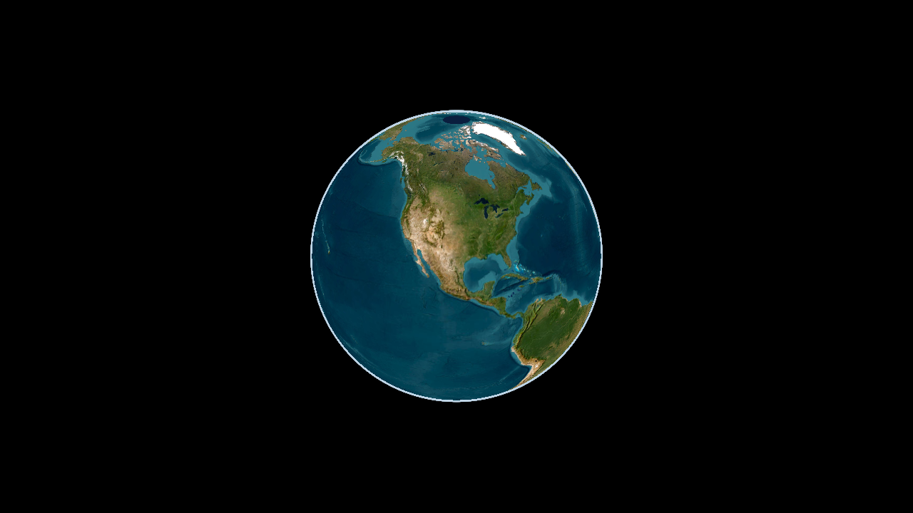
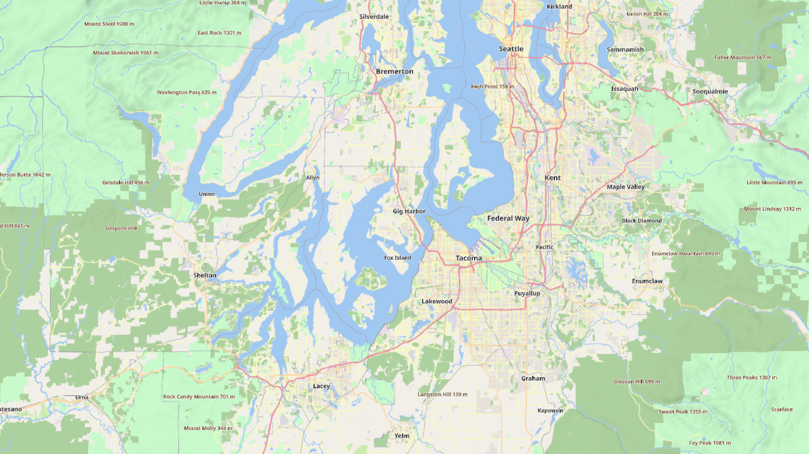
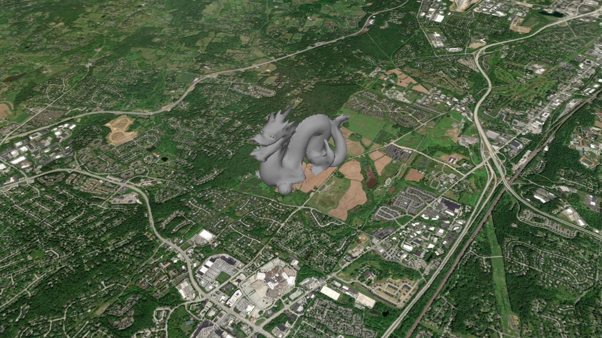
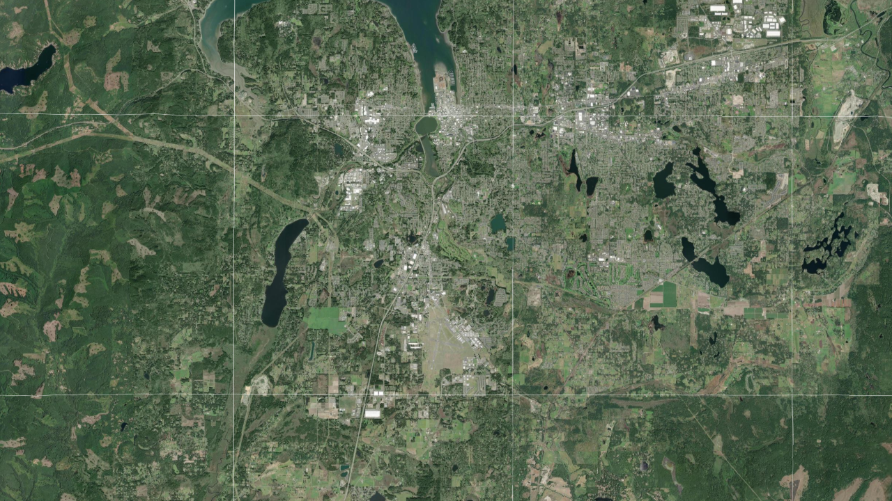
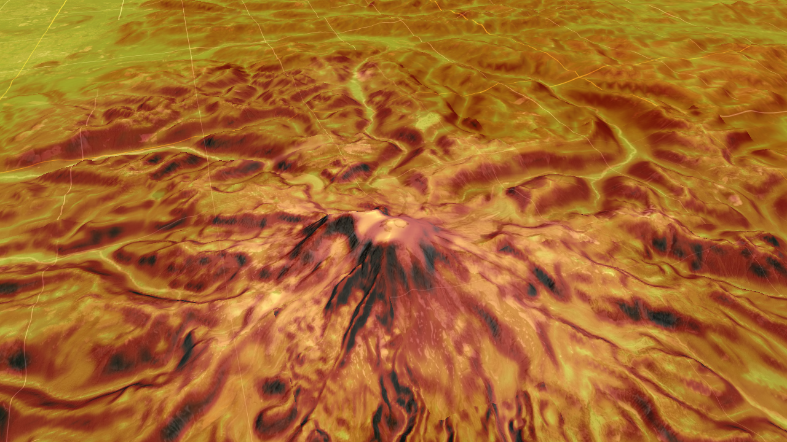

# OpenTAKEngine

A lightweight, cross-platform C++ map engine modeled on the TAK map engine: a WGS84 globe draped with 2D imagery, 3D terrain, vector features, labels, 3D models and 3D Tiles.

Targets Windows, macOS, Linux, Android, iOS and iPadOS from one codebase. Rendering goes through sokol_gfx (Direct3D 11, Metal, OpenGL 4.1, OpenGL ES 3) with shaders written once. CI builds all five targets on every push.

Website and downloads: https://grangedevgroup-code.github.io/OpenTAKEngine/

See [docs/PLAN.md](docs/PLAN.md) for the architecture and decisions, and [docs/EMBEDDING.md](docs/EMBEDDING.md) for using the engine from Android, iOS, macOS, Windows, C# and Qt. [docs/RENDERING.md](docs/RENDERING.md) covers continuous, zero-blank rendering and how it is measured; [docs/FORMATS.md](docs/FORMATS.md) is the data import/export compatibility matrix, and [docs/OFFLINE.md](docs/OFFLINE.md) covers caching and airgapped networks. [docs/PHOTOREALISM.md](docs/PHOTOREALISM.md) covers photogrammetry and photorealistic 3D Tiles, [docs/XR.md](docs/XR.md) VR, AR and stereo, and [docs/MILITARY.md](docs/MILITARY.md) the military feature set and what to add next.

| Globe | Terrain | First person |
| --- | --- | --- |
|  |  |  |
| **Vector tiles** | **3D Tiles** | **Features and labels** |
|  |  |  |
| **MGRS grid** | **Viewshed** | **Elevation heat map** |
|  |  |  |
| **2525 units, contours, bullseye, R&B** | **Terrain slope** | **Airgapped, empty cache** |
|  |  |  |

ATAK reference captures are in `screenshots/atak`.

## Features

**Globe and camera**
- TAK-style scene model: focus point, ground resolution, azimuth, tilt up to 84 degrees, terrain collision
- 2D/3D toggle, first-person mode (walk and look at eye height), animated fly-to
- Atmosphere and sky from ground level to space

**Imagery**
- Online XYZ, TMS, quadkey, WMS 1.1.1/1.3.0 (EPSG:3857 and 4326), WMTS templates, MOBAC XML (including multi-layer sources)
- Offline MBTiles, GeoPackage tiles (any tile matrix), osmdroid SQLite, and GeoTIFF/NITF/MrSID/JPEG2000/GeoPDF/CADRG via the optional GDAL module
- SQLite tile cache with offline mode and fallback, region download
- Mapbox Vector Tiles (TileJSON or MBTiles) rendered on the GPU with place, peak and water labels
- `file://` URL templates for offline `{z}/{x}/{y}` tile folders
- Layer stacking with opacity, KML/KMZ ground overlays, arbitrary image overlays

**Terrain**
- WGS84 quadtree, 33x33 post meshes with skirts, screen-space-error LOD, slope shading ("enhanced depth perception"), exaggeration, x-ray transparency
- Terrarium and quantized-mesh elevation tiles, DTED 0-3 and SRTM HGT folders, GDAL DEMs, EGM96 geoid (heights are HAE)
- Line of sight, viewshed, elevation profile, elevation heat map

**Vectors, labels and models**
- KML/KMZ (styles, style maps, icons, MultiGeometry, gx:Track), GeoJSON (simplestyle), GPX, Shapefile, plus any OGR format via GDAL
- Ground-clamped lines and polygons draped into the terrain texture, 3D lines, icons, SDF labels with decluttering, hit testing
- MGRS/UTM conversions and a draped MGRS grid
- glTF/GLB models, OGC 3D Tiles 1.0/1.1 (tileset.json, .3tz, URLs, external and implicit tilesets, b3dm, i3dm, pnts, cmpt, glb/glTF; Draco, meshopt and KTX2 compression; GPU instancing), LAS point clouds (WGS84 and UTM natively, any CRS through the GDAL module)
- Photorealistic 3D Tiles from Google and Cesium ion (`ion://` URIs, token refresh, on-screen credits) or your own photogrammetry; metallic-roughness materials with normal, emissive and occlusion maps, unlit photogrammetry, lighting by the real sun for a given time
- VR and AR hosts: `frameXr` renders any number of OpenXR-style eye views with one tile update per frame, table-top scale, side-by-side stereo ([docs/XR.md](docs/XR.md))

**Military**
- MIL-STD-2525C and 2525D point symbols drawn by the engine: affiliation frames and colours for space, air, ground, sea surface, subsurface and SOF; planned and assumed friend/suspect/pending dashed frames; echelon, headquarters staff, task force, feint/dummy and installation amplifiers; joker/faker/exercise markers; common unit, equipment, air, sea and subsurface icons. CoT `a-` types (and `Style::sidc`) become 2525 icons automatically ([sheet](screenshots/opentakengine/22_mil_std_2525_symbols.png)).
- WMM2025 magnetic declination and inclination (matches the NOAA test values), UTM grid convergence, bearings in true/magnetic/grid north, degrees or NATO mils
- Coordinates: decimal, DM, DMS, MGRS (including polar UPS), UTM/UPS and GARS formatting, and a parser that accepts all of them
- Vincenty geodesics (inverse, direct, densified paths, area), range rings, bullseye, range and bearing lines, sectors, ellipses and geodesic circles as features
- Contour lines from loaded elevation (MSL, major/minor with labels), terrain slope shading, MGRS, lat/lon and GARS grids
- Sun and moon position, moon phase and illumination, BMNT/EENT and other twilight times, moonrise/moonset and ground illuminance in lux for night-vision planning
- UAS full-motion video metadata: MISB ST 0601 KLV from MPEG-TS or raw KLV becomes sensor and frame-centre tracks, image footprints and line of sight
- Tracks past their CoT stale time are drawn faded

**Loading behaviour**
- Readiness-gated refinement: a parent tile stays on screen until its children are fully loaded, so zooming never shows tiles popping in
- Parent, child and zoom-out prefetch inside a GPU memory budget (512 MB desktop, 256 MB mobile by default), cross-fade between levels
- Separate local (cache, files) and network loader pools
- Airgap-ready cache: expired tiles shown instantly and refreshed in the background, unreachable hosts fail fast and are re-probed, pinned region downloads that wait out outages, size limit, MBTiles/GeoPackage export and import into the cache, built-in world backdrop where nothing is cached ([docs/OFFLINE.md](docs/OFFLINE.md))

**Size and speed**
- The whole engine is about 4 MB (Windows DLL; Android arm64 library 4 MB, 1.8 MB compressed; the Android viewer APK is 1.8 MB) including SQLite, image decoders, the label font and the geoid
- CPU time per frame on a 2015 desktop i5: 0.2 ms (globe), 0.5 ms (street), 0.9 ms (tilted terrain), 1.1 ms (first person)

**Bindings**
- C ABI `include/ote/ote.h` and `opentakengine_c` shared library
- Android AAR with `OpenTakView` (`scripts/android_aar.py`), Swift `OpenTAKView` and xcframework (`scripts/apple_xcframework.sh`), C# wrapper (`bindings/dotnet`)

## Install

Releases on GitHub carry ready-made packages:

| Platform | Package |
| --- | --- |
| Windows x64 | `opentakengine-<version>-windows-x86_64.zip` |
| Linux x86_64 and arm64 | `.deb`, `.rpm` and `.tar.gz` |
| macOS (Apple silicon and Intel) | `opentakengine-<version>-macos-universal.tar.gz` |
| FreeBSD | `.pkg` (`pkg add ./opentakengine-<version>-freebsd-x86_64.pkg`) and `.tar.gz` |
| OpenBSD, NetBSD | `.tar.gz` |
| Android | `opentakengine-<version>.aar` and a viewer APK |
| iOS, iPadOS, macOS apps | `OpenTAKEngine-<version>.xcframework.zip` |
| .NET | `OpenTakEngine.<version>.nupkg` with native libraries for Windows, Linux and macOS |

The desktop packages contain the C ABI as a shared library (`ote.h`), the viewer, the documentation and the license texts of bundled libraries. Use them from CMake with `find_package(OpenTAKEngine)` and `target_link_libraries(app PRIVATE OpenTAKEngine::opentakengine_c)`, or through `pkg-config opentakengine`. The C++ API is used by building the engine from source (`add_subdirectory` or `FetchContent`). `SHA256SUMS.txt` lists checksums for every file.

## Build

Windows (Visual Studio 2022 or newer, CMake 3.24+, Ninja):

```
build.cmd
build\windows\apps\viewer\ote_viewer.exe
```

Linux: `cmake -S . -B build -G Ninja && cmake --build build` (libcurl, X11, Xi, Xcursor and OpenGL development packages; add `-DOTE_WITH_GDAL=ON` and libgdal-dev for the GDAL module).

FreeBSD, OpenBSD and NetBSD: `sh scripts/bsd_build.sh` installs the build dependencies (cmake, ninja, curl, X11 and Mesa), builds and runs the tests; `OTE_PACKAGE=1` also makes the packages. sokol-shdc has no BSD binaries, so these hosts use the GLSL 4.1 shader headers checked in under `src/render/shaders/generated` (`cmake --build build --target ote_pregenerate_shaders` refreshes them; CI fails when they are stale).

macOS: `cmake -S . -B build -G Ninja && cmake --build build`. iOS: `cmake -S . -B build -G Xcode -DCMAKE_SYSTEM_NAME=iOS`.

Android: `python scripts/android_apk.py --install --run` builds, signs and installs a standalone viewer APK (needs the Android SDK and NDK).

OpenGL on Windows (to check the GL path used on Linux and Android): add `-DOTE_GFX_BACKEND=SOKOL_GLCORE -DOTE_SHDC_LANG=glsl410` to the CMake configure.

Tests: `ctest --test-dir build/windows` runs the unit tests (geodesy, MGRS, tile matrices, camera, geoid, file parsers, quantized mesh); CI runs them on Windows, Linux, macOS, FreeBSD, OpenBSD and NetBSD.

Packages: `cpack --config build/CPackConfig.cmake` makes the platform packages; [docs/RELEASING.md](docs/RELEASING.md) describes a release.

## Viewer

```
ote_viewer [--view lat,lon,gsd,tilt,azimuth] [--preset 0..3] [--size WxH]
           [--mbtiles f] [--gpkg f] [--osmdroid f] [--gdal f] [--mobac xml]
           [--features file] [--model path,lat,lon,heading,scale] [--tileset dir|.3tz|url|ion://id?access_token=t] [--las file]
           [--stereo eye_separation_m (0 = auto)] [--sun unix_seconds|now]
           [--elevation-dir dir] [--gdal-dem f] [--quantized-mesh url] [--terrain 0|1] [--exaggeration x]
           [--cache dir] [--offline 1] [--cache-limit MB] [--import file] [--export w,s,e,n,minz,maxz,file]
           [--memory MB] [--grid 1] [--grid-type 0|1|2] [--heatmap 1] [--slope 1] [--contours interval]
           [--bullseye lat,lon,radius] [--rings lat,lon,spacing,count] [--rb lat1,lon1,lat2,lon2]
           [--first-person heading,pitch[,height]] [--download w,s,e,n,minz,maxz]
           [--shot out.png] [--shot-timeout s] [--zoom-test lat,lon,gsd,tilt,az,seconds] [--zoom-start s] [--diag 1]
```

- Input is handled by the engine's shared controller (`engine.input()`, `ote_pointer_*` in the C ABI), so every host behaves the same:
  - Mouse: left drag pans (with inertia), wheel zooms at the cursor, right or middle drag (or Ctrl/Alt + left) rotates and tilts, double click zooms in; Shift + wheel tilts, Alt + wheel rotates.
  - Touch and pen: one finger pans with fling, pinch zooms about the fingers, twist rotates past a 10° threshold, two-finger vertical drag (or three fingers) tilts, double tap zooms in, double-tap-and-drag zooms continuously, two-finger tap zooms out, long press reports a callback. Windows touchscreens and pens use `WM_POINTER`.
  - Trackpads: pinch (magnify) zooms and rotate rotates on macOS and iPad; precise two-finger scroll pans.
  - Keys: arrows or `W`/`A`/`S`/`D` pan (walk in first person), `+`/`-` zoom, `Q`/`E` rotate, `PageUp`/`PageDown` tilt, `N` north up, `T` level the camera.
  - Panning keeps the current heading; only explicit rotation changes it. The poles are reachable at any zoom without the view spinning.
- Viewer keys: `1`-`4` imagery presets (satellite, satellite + USGS topo, OpenStreetMap, vector tiles), `R` reset north and tilt, `Y` terrain, `O` exaggeration, `U` depth shading, `H` heat map, `G` grid (MGRS, lat/lon, GARS, off), `K` terrain slope, `L` contours for the view, `B` bullseye at the cursor, `C` range and bearing (press at both ends), `V` viewshed at the cursor, `F` fly to Mount Rainier, `M` 2D/3D, `P` first person, `X` terrain x-ray.
- `--shot` renders offscreen until everything has loaded, writes the PNG plus a `.txt` with statistics, and exits. `--zoom-test` flies to a view and reports incomplete, coarse (two or more levels of fallback) and blank frames; `--zoom-start s` starts it after a fixed delay. `--diag 1` logs subtree collapses and deep-fallback tiles.
- On Android the viewer also reads arguments from `Android/data/com.opentakengine.viewer/files/args.txt` and logs statistics under the logcat tag `OpenTAKEngine`.
- Environment: `OTE_TRACE=file` per-frame trace, `OTE_WATCHDOG=file` main-thread stack dump on a 3 s stall, `OTE_LOG=file` sokol validation messages, `OTE_PROFILE=file` per-section CPU times, `OTE_PERF=file` frame and cache statistics, `OTE_NET_DELAY_MS` / `OTE_NET_JITTER_MS` / `OTE_NET_FAIL_RATE` / `OTE_NET_TIMEOUT_RATE` / `OTE_NET_CORRUPT_RATE` / `OTE_NET_404_RATE` / `OTE_NET_UNREACHABLE` network fault injection.

## License

Apache License 2.0 ([LICENSE](LICENSE)): use, copy, modify and sell OpenTAKEngine for any purpose, in open or closed products, without having to share your changes. Copies you distribute keep the license text and mark the files you changed. Every contributor grants a patent license for their contributions, and contributions are accepted under the same license.

Bundled libraries and data keep their own licenses, listed with what each asks for in [docs/THIRD_PARTY.md](docs/THIRD_PARTY.md). OpenTAKEngine is written independently. The upstream TAK engine (GPLv3) was studied for behaviour and architecture only; no upstream code is included.

## Security

See [SECURITY.md](SECURITY.md) for how to report a vulnerability.
