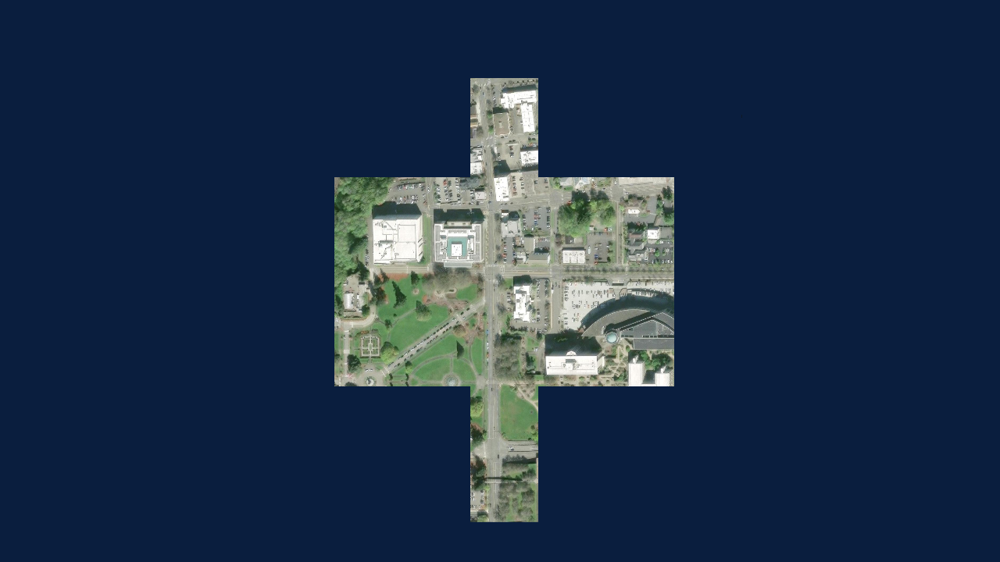
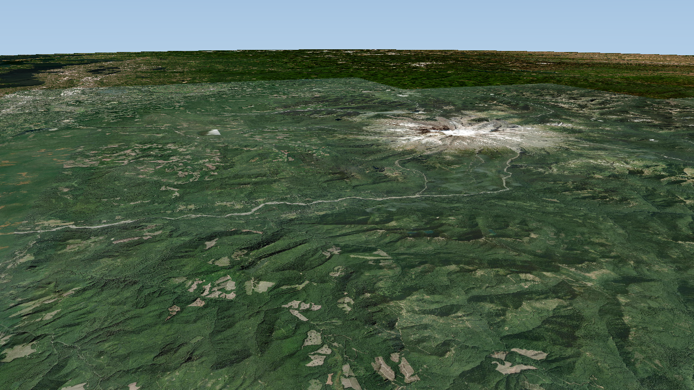

# OpenTAKEngine

A lightweight, cross-platform C++ map engine modeled on the TAK map engine: a WGS84 globe draped with 2D imagery tile pyramids, with 3D terrain, vectors, labels and models to follow.

Targets: Windows, macOS, Linux, Android, iOS, iPadOS. Graphics run through sokol_gfx (D3D11, Metal, GL 4.1, GLES3) from one shader source.

See [docs/PLAN.md](docs/PLAN.md) for the architecture, decisions and phases. Research notes on the upstream engine are in `research/research_notes/`.

## Status

Phase 1 (globe and imagery) works on Windows:

- TAK-style scene model: focus point, ground resolution (m/px), azimuth, tilt up to 84 degrees, 45 degree vertical FOV, camera collision
- WGS84 EPSG:4326 terrain quadtree with screen-space-error LOD, frustum and horizon culling, relative-to-center vertices
- Surface megatexture: imagery composed into a 256 px texture per terrain tile, ancestor fallback while children load
- Online XYZ/TMS/quadkey sources with `{z} {x} {y} {-y} {q} {s}` and MOBAC `{$z} {$x} {$y} {$q} {$serverpart}` templates, layer stacking and opacity
- Async tile loading on a worker pool (WinHTTP on Windows, libcurl on Linux, NSURLSession on Apple), nearest-first, cancelled when out of view
- Atmosphere: sky gradient near the ground, blue rim from space, black space

| Globe | Street level | Tilted |
| --- | --- | --- |
|  |  |  |

ATAK reference captures are in `screenshots/atak`.

## Build

Windows (Visual Studio 2022 or newer, CMake 3.24+, Ninja):

```
build.cmd
build\windows\apps\viewer\ote_viewer.exe
```

Linux: `cmake -S . -B build/linux -G Ninja && cmake --build build/linux` (needs libcurl, X11, Xi, Xcursor, OpenGL dev packages).

## Viewer

```
ote_viewer [--view lat,lon,gsd,tilt,azimuth] [--preset 0|1|2] [--size WxH] [--shot out.png] [--shot-timeout seconds]
```

- Left drag: pan. Wheel or `+`/`-`: zoom. Right drag or arrow keys: rotate and tilt. `R`: north up, no tilt.
- `1` World Imagery, `2` World Imagery + USGS Topo, `3` OpenStreetMap.
- Touch: one finger pans, pinch zooms, twist rotates, two-finger vertical drag tilts.
- `--shot` renders offscreen until all tiles are loaded, writes the PNG plus a `.txt` with stats, and exits.
- Environment: `OTE_TRACE=file` logs per-frame timings, `OTE_WATCHDOG=file` dumps the main thread stack if a frame stalls for 3 s, `OTE_LOG=file` captures sokol messages.

## License

OpenTAKEngine is written independently. The upstream TAK engine (GPLv3) was studied for behaviour and architecture only; no upstream code is included.
